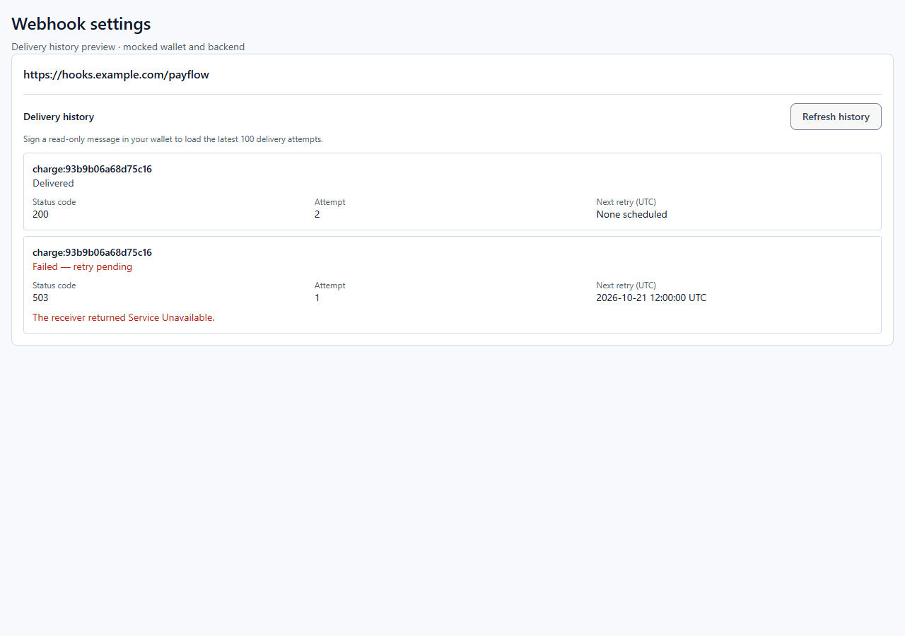
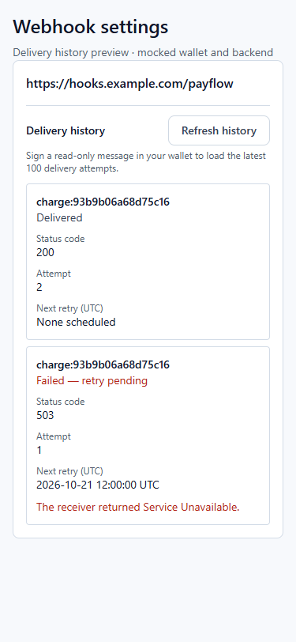
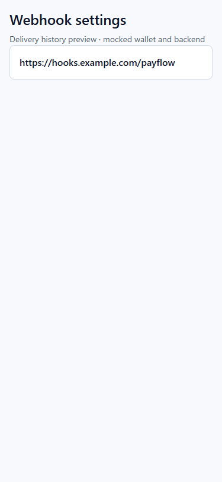

# Webhook delivery history (proposed backend #140 contract)

The history UI is hidden when `NEXT_PUBLIC_API_URL` is empty. It appears beneath
each registered webhook; the existing webhook list still depends on backend
support. History is loaded only after the merchant clicks **Refresh history**
and approves a wallet message. This does not submit a transaction.

Backend #140 is not deployed at implementation time. The following is a proposed
wire format, not a claim of compatibility with a deployed endpoint. Confirm it
with that implementation before enabling history in production.

`GET /api/webhooks/:id/deliveries` sends these headers:

| Header | Value |
| --- | --- |
| `X-Payflow-Merchant` | Connected Stellar public address |
| `X-Payflow-Timestamp` | Unix seconds when the signing request began |
| `X-Payflow-Signature` | Base64 signature returned by Wallets Kit `signMessage` |

The exact UTF-8 message is the compact JSON serialization of
`["payflow-webhook-deliveries:v1", merchant, webhookId, timestamp, networkPassphrase]`.
The webhook ID is a string and the timestamp is a number. This binds the proof
to a read-only action, merchant, webhook and network. Never persist the proof or
put it in a URL. The server must allow these headers in CORS, reject expired
proofs (the existing registration route uses ten minutes), verify ownership of
the webhook, and verify the wallet's message signature. Freighter uses
[SEP-53 message signing](https://github.com/stellar/stellar-protocol/blob/master/ecosystem/sep-0053.md);
the registration route's existing raw-byte Ed25519 verification cannot simply
be reused for a SEP-53 signature. Wallets without message signing fail visibly.

Proposed response, newest attempts first and capped at 100:

```json
{
  "deliveries": [
    { "id": 12, "event_id": "charge:transaction-hash", "status": "delivered", "http_status": 200, "error": null, "attempt": 2, "retry_at": null },
    { "id": 11, "event_id": "charge:transaction-hash", "status": "pending", "http_status": 503, "error": null, "attempt": 1, "retry_at": 1792584000 }
  ]
}
```

Field names match the existing dispatcher's rows, with `event_id` exposed to the
client and `retry_at` nullable. `status` is `pending`, `delivered`, or `failed`.
Every attempt must remain a separate row; the frontend does not collapse rows
by event ID. Only pending attempts display a next retry, in UTC. A pending
attempt with an HTTP failure or error is labelled **Failed — retry pending**.

Missing endpoints, failed authentication, network failures, timeouts and invalid
responses return `null` through the API client and show an unavailable message
with a retry control. An empty successful list instead says **No deliveries yet**.
Changing account, disconnecting, or selecting the wrong network removes history
and aborts in-flight reads; a late signature cannot start a request for the old
account. The wallet address and network are also rechecked before and after signing.

## UI verification

The actual `WebhookDeliveryHistory` component was rendered with production CSS
in Chrome at 1280px and 375px, using a mocked wallet and backend. Both attempts
were visible without horizontal overflow. Empty, unavailable, wrong-network,
disconnected and API-off states were also exercised. This is UI evidence, not
an end-to-end check against the pending backend endpoint or a real wallet.




